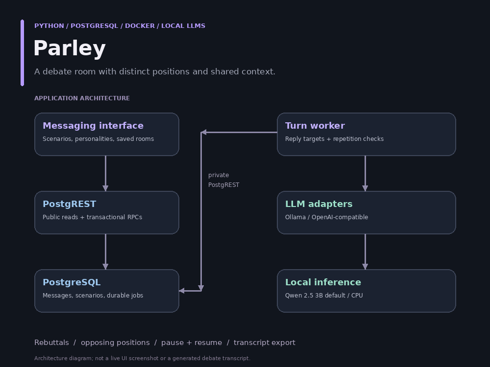

# Parley — AI debate room



A local, Docker-based multi-agent conversation app. Create a scenario, choose 2–6 characters, assign personality types and model profiles, and watch them debate in a messaging-style interface. Join the conversation yourself, pause/resume, revisit saved rooms, and export a Markdown transcript.

All generated messages come from an LLM. There is no canned-response fallback. Small local models remain limited in reasoning and instruction following; this is a conversation experiment, not a source of verified facts.

## Quick start

Requirements: Docker Engine with Compose v2, a working internet connection for the first image/model downloads, and an available localhost port 8080. Plan for several GB of free disk and RAM; 8 GB system RAM is a practical starting point, not a verified minimum. No dedicated GPU or Python packages are needed on the host.

```bash
cd ai-debate
cp .env.example .env
docker compose up --build -d
```

Open **http://127.0.0.1:8080**. The interface is available while the initial model downloads. Wait for **Local engine ready**, choose a starter or create a room, and click **Start conversation**.

```bash
# Follow first-time model download progress:
docker compose logs -f model-init

# Inspect services or generation errors:
docker compose ps
docker compose logs --tail=100 backend rest worker-rest db ollama

# Stop while preserving models and conversations:
docker compose down

# Start again:
docker compose up -d
```

The default model is `qwen2.5:3b` (approximately 1.9 GB of model weights; runtime RAM is higher). It uses CPU inference, a 4,096-token context window, 256 reply tokens, one loaded model, and one generation at a time. The integrated GPU needs no configuration. The Ollama container defaults to a 4 GB memory ceiling, configurable with `OLLAMA_MEMORY_LIMIT`. This model is slower than the original 0.5B default; actual performance needs checking on your laptop.

## Upgrade an existing installation

From the `ai-debate` directory:

```bash
sh scripts/upgrade-debate.sh
```

This applies an idempotent database migration, downloads Qwen 2.5 3B, and rebuilds the worker. It preserves volumes, transcripts, and saved scenarios. Refresh the browser and create a **new room from the scenario library** to use the stronger seeded model and opposing starter positions. Existing rooms keep their original model/position snapshots, but receive the improved prompt logic. Existing `.env` files may still set `DEFAULT_MODEL=qwen2.5:0.5b`; the upgrade script explicitly downloads 3B regardless. Change that variable to 3B for consistent future initialization.

## How the debate is directed

Personality determines speaking style; a separate explicit position determines what someone defends. The defaults oppose each other, and the scenario editor requires a position. If an older scenario has an empty position, the backend assigns contrasting roles by participant order.

Each turn gets a specific opponent message to rebut, prioritizing direct challenges received since the speaker's own last turn. Its own previous answer is supplied separately with an instruction to develop rather than repeat it. Up to 24 recent messages provide previous-round context. The final round asks speakers to articulate remaining disagreements rather than manufacture consensus.

Speakers must address an opponent by name, contest a concrete assumption or claim, advance a new reason, and ask a pointed question. A surface check catches near-duplicate answers, missing addressees, and generic agreement openings; it requests one targeted rewrite. If the same checks fail again, the turn fails visibly instead of silently saving the poor reply. These checks cannot judge the truth or strength of an argument, and do not guarantee natural behavior from every model. Genuine narrow concessions are allowed.

## Using the app

- **New conversation:** set a title, question, ground rules, and 1–20 rounds. Each participant speaks once per round.
- **Choose your cast:** select analyst, skeptic, optimist, pragmatist, mediator, visionary, or custom. Add a stance, character instructions, accent color, and model profile for each person.
- **Scenario library:** save reusable scenarios, open new rooms, or customize a copy. Saving a copy preserves the original. Existing rooms use immutable configuration snapshots.
- **Conversation controls:** start, pause, resume, or retry a failed turn. Pause immediately invalidates any response currently being generated. The HTTP inference request may finish in the background, but that discarded response is never saved.
- **Join in:** send messages using Enter (Shift+Enter for a newline). Characters see human messages when their next generation starts. A message sent during a generation affects subsequent turns.
- **History:** PostgreSQL saves rooms, messages, model metadata, generation duration, and turn progress. Reloading or restarting containers preserves them.
- **Export/delete:** download a Markdown transcript or permanently delete a room after confirmation. Saved scenarios remain available.

Replies appear when a whole turn completes; the MVP does not stream individual tokens. The UI polls every two seconds and shows a thinking indicator. The sidebar lists the 100 most recently updated rooms; transcript reads are capped at 1,000 messages per room in this MVP.

## Different models and backends

### Ollama

Download a model before using its profile:

```bash
docker compose exec ollama ollama pull smollm2:135m
# Another option, with more memory use:
docker compose exec ollama ollama pull qwen2.5:1.5b
```

Go to **Models & settings → Add a model profile**. Choose Ollama, enter the exact model identifier, and choose a temperature/token budget. Assign the profile to a character in a new scenario. Multiple profiles can use the same weights with different generation settings. Distinct model identifiers are supported per character; swapping models can slow a laptop down.

`DEFAULT_MODEL` controls the automatic first download only. The seeded scenario profiles use `qwen2.5:3b`; if you change the download variable, add/select a matching profile in the UI.

### OpenAI-compatible servers

For LM Studio, llama.cpp server, or another compatible chat-completion API, set these in `.env`:

```dotenv
OPENAI_BASE_URL=http://host.docker.internal:1234/v1
OPENAI_API_KEY=
```

Then apply the configuration:

```bash
docker compose up -d --force-recreate backend
```

Add a profile with the **OpenAI-compatible** provider and the model name expected by your server. The base URL must include `/v1` if your provider requires it. The server must be reachable from Docker; a host service bound only to its own loopback may need its listen address adjusted. Keys remain in the backend environment, never in browser storage or PostgreSQL. A configured remote provider sends the scenario and recent context to that provider. The adapter supports standard `/chat/completions` text responses; vendor-specific reasoning/tool APIs are outside this MVP.

Provider adapters live in `backend/providers.py`. Add an adapter implementing `generate(profile, messages)`, register it in `configured_providers()`, and extend the database/UI provider choices for a new protocol.

## Architecture

```text
Browser → Nginx (127.0.0.1:8080)
            ├── static messaging UI
            ├── /rest/*   → public PostgREST → PostgreSQL
            └── /engine/* → Python health/model discovery

Python sequential worker → private worker PostgREST → PostgreSQL
                         → Ollama / OpenAI-compatible server
```

PostgREST is the actual persistence API for both the browser and worker. Python does not connect directly to PostgreSQL. The public database role can read application data and call narrowly granted scenario/model/conversation RPCs. It cannot insert arbitrary messages or access jobs/worker RPCs. A separate internal PostgREST service has the worker role. PostgreSQL, both PostgREST services, Ollama, and the worker have no published host ports.

Tables: `model_profiles`, `scenarios`, `participants`, `conversations`, `messages`, and `jobs`. Foreign keys connect scenario participants to their models and messages/jobs to their conversations. Schema and seed files run on first initialization of the named database volume. Later schema changes need explicit migrations; restarting an existing volume does not reapply initialization SQL.

### Durable turn execution

1. Starting a room creates one unique pending job in the same transaction as its status update.
2. A worker claims one turn through a database RPC using row locks and a five-minute lease token.
3. The worker builds personality instructions plus topic/rules and a bounded excerpt of recent discussion, then calls the chosen LLM (120-second request timeout).
4. Completion validates the lease and atomically stores the response and advances the turn. Duplicate or invalidated completions are rejected.
5. The next participant gets a pending job, or the room becomes complete. Generation failures are saved for manual retry. A worker/container crash leaves a lease that another poll can reclaim after expiry.

All persisted history remains in PostgreSQL, but the model sees only a bounded recent excerpt to fit the bounded context window. Long topics, character instructions, and older messages are truncated for inference. This MVP uses character budgets rather than exact provider tokenization; long non-English inputs may be truncated further by the model server. Short scenarios work best. There is no generated summary, automatic fact checking, or guarantee that a small model follows every personality instruction.

## Checks and integration tests

Dependency-free backend unit tests, JavaScript syntax, shell syntax, and Compose configuration:

```bash
sh scripts/check.sh
```

The unit tests mock provider HTTP calls; they do **not** establish successful model inference. Live integration checks require the Docker stack:

```bash
# Stop only the worker briefly so SQL lease tests cannot race it.
docker compose stop backend
docker compose exec -T db psql -U postgres -d debate -v ON_ERROR_STOP=1 < tests/database.sql
docker compose up -d backend

# Real API + PostgreSQL + model inference; wait for model-init first:
python3 scripts/smoke.py
```

The SQL test transaction rolls back its data and checks pause/stale replies, duplicate prevention, expired lease recovery, failed-turn retry, completion, cascade deletion, and role separation. Run it against a development database. The smoke test generates six real agent replies over three rounds and prints the transcript, verifies saved messages, and leaves a test scenario/room for inspection.

A useful manual UI pass: create a custom two-person room, start it, pause during thinking, add a human message, resume, reload, inspect the completed history, export it, and test mobile layout and keyboard navigation. See `VALIDATION.md` for what was actually verified in the build environment.

## Backup and restore

Create a consistent SQL backup without deleting any volumes:

```bash
docker compose exec -T db pg_dump -U postgres -d debate > debate-backup.sql
```

Restore into a **new, empty** database configured with the same app roles; use PostgreSQL's `psql` or restore tooling appropriate to your target. A database dump does not contain the Ollama model volume. Do not run initialization schema SQL again on top of a restored schema. Verify restores in a separate development stack before relying on backups.

## Deployment scope and troubleshooting

This is a **single-user local workspace**, not a multi-user hosted product. It intentionally has no account/login system. Anyone with access to the local port shares the workspace. Keep the localhost binding. Public deployment requires authentication, per-user authorization, TLS, and operational hardening.

- **Docker socket permission denied:** run from a terminal/account that already has access to Docker. The source code cannot grant itself daemon access.
- **No model/failed generation:** check `model-init` and `ollama` logs, verify the exact identifier in settings, then use Retry turn.
- **Out of memory:** try Qwen 2.5 1.5B (with weaker debate quality), reduce reply tokens, and close other applications. CPU generation speed depends on the laptop.
- **Database API unavailable:** inspect `db`, `rest`, and `worker-rest` logs. Default credentials are for local development. If replacing database passwords, use URL-safe values in the Compose connection URIs; on an existing volume, changing environment variables alone does not change database role passwords.
- **PostgreSQL data survives edits:** this is intentional. Do not remove named volumes to apply a code change. Volume deletion permanently removes saved data.
- **Restart during a reply:** allow up to five minutes for a lost worker lease to expire, or pause and resume the room to invalidate it immediately.

## References

- [Ollama chat API](https://docs.ollama.com/api/chat)
- [Ollama resource/concurrency settings](https://docs.ollama.com/faq)
- [Qwen 2.5 model sizes](https://ollama.com/library/qwen2.5)
- [PostgREST configuration](https://docs.postgrest.org/en/v12/references/configuration.html)
- [PostgREST relationship embedding](https://docs.postgrest.org/en/v12/references/api/resource_embedding.html)
